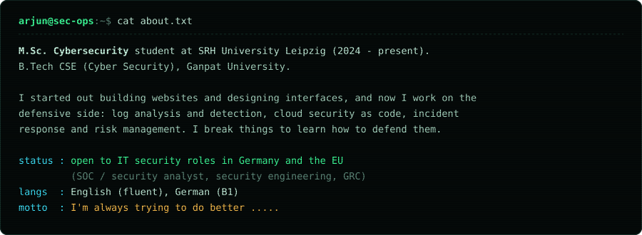
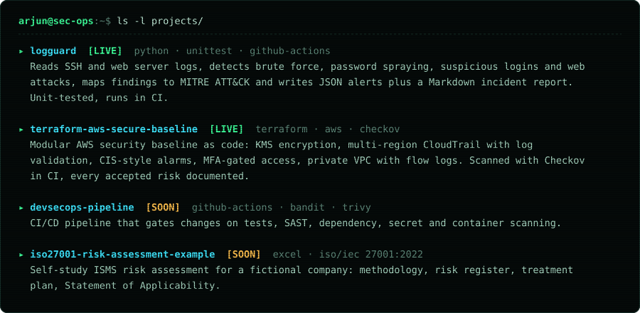
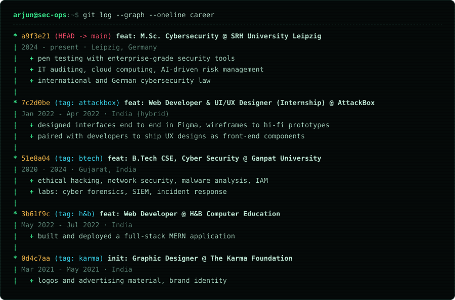
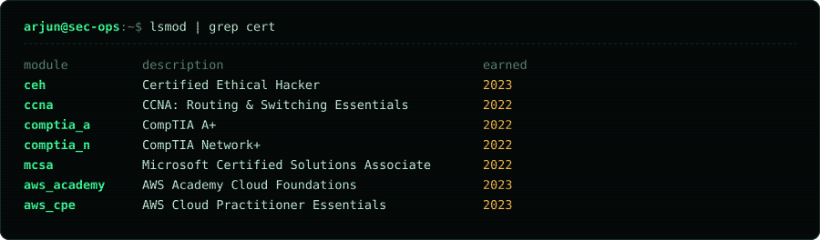
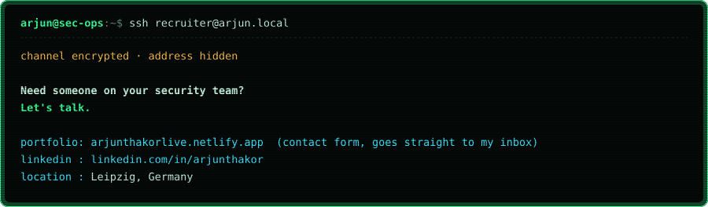

[**portfolio**](https://arjunthakorlive.netlify.app) &nbsp;·&nbsp; [**linkedin**](https://www.linkedin.com/in/arjunthakor) &nbsp;·&nbsp; [**logguard**](https://github.com/The-Arjun-Thakor/logguard) &nbsp;·&nbsp; [**terraform-aws-secure-baseline**](https://github.com/The-Arjun-Thakor/terraform-aws-secure-baseline)

[**open logguard**](https://github.com/The-Arjun-Thakor/logguard) &nbsp;·&nbsp; [**open terraform-aws-secure-baseline**](https://github.com/The-Arjun-Thakor/terraform-aws-secure-baseline)

[**portfolio &amp; contact form**](https://arjunthakorlive.netlify.app) &nbsp;·&nbsp; [**linkedin**](https://www.linkedin.com/in/arjunthakor)

built in a terminal near you &nbsp;·&nbsp; <code>sudo hire-arjun --now</code>

